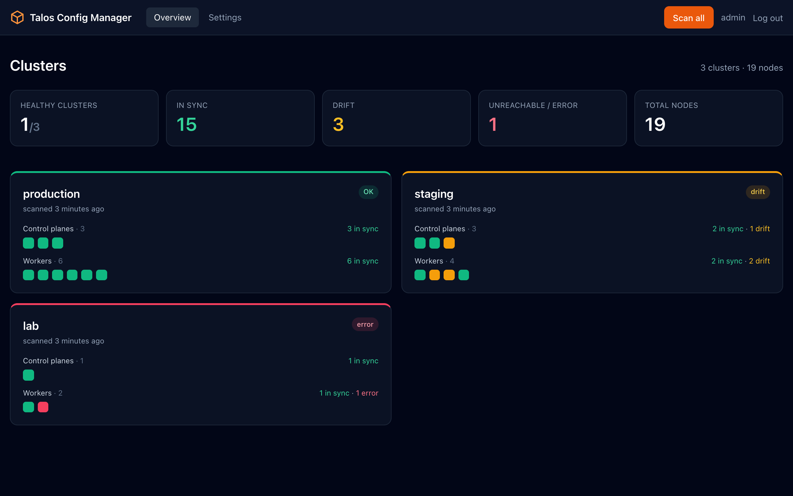

# Talos Config Manager

Web app that compares the live machine config of every Talos node with the original
`controlplane.yaml` / `worker.yaml` and shows the configuration drift per node,
split into **control planes** and **workers**, for **multiple clusters** at once.
It can also edit patches and apply them to the nodes of a cluster.



- Overview with the status of all clusters: OK / drift / error, with a coloured block per node
- Per cluster its own base folder, files, patches, ignore rules and scan interval
- Node discovery via `talosctl get members` (or a manual node list)
- Per node: status *in sync* / *drift* / *unreachable*, number of differences, since when
- Detail page with a table of differing paths and a side-by-side YAML diff
- View a node's full live config and save it as YAML
- "Differs from majority": nodes of the same role that drift differently from the rest
- Activity log: who changed what (settings, files, patches, rollouts, clusters, certificates,
  logins), also as JSON lines in the container log (see *Activity log*)
- New node tab: generate the machine config for an extra control plane or worker from the baseline
  (see *Adding a node*)
- Consistency tab: differences between nodes of the same role, also when a node-specific patch
  explains them (see *Consistency between nodes*)
- Patches (strategic merge, JSON6902, multi-document) per cluster, role or node included in the baseline
- Patches tab: edit or write a patch, validate it with a dry run per node, and apply it node by node
  (see *Applying patches*)
- Ignore rules for paths that legitimately differ per node (hostname, interfaces, install disk, …)
- Periodic scan (every 15 min by default) and a "Scan now" button

## Why a separate Docker container?

The app deliberately runs **outside** the clusters it monitors. If you ran it as a workload in the
cluster itself, it would go down at exactly the moment you need it: if the cluster is down, or the
nodes it runs on are unreachable, so is the drift detection. Run it alongside (on a management
server, a VM or your own machine with Docker) and the overview keeps working, showing exactly which
nodes are *unreachable* or since when they have drifted.

In addition:

- **One place for all clusters.** One container monitors multiple clusters; no agent per cluster.
- **Nothing to install on the host.** Talos has no shell or SSH; everything goes through the Talos
  API with `talosctl`. The image contains talosctl, lego (Let's Encrypt) and Python. The host only
  needs Docker.
- **Locked down.** The container runs as non-root with a read-only root filesystem and without
  capabilities (see *Security*).

Another (management) cluster works too, as long as it is not the cluster you are monitoring. This
repo contains no manifests for that; `docker-compose.yml` shows which volumes, secrets and
security settings are needed.

### Network access to the clusters

The app talks to the Talos API (`apid`) on **TCP 50000**:

- If the talosconfig has `endpoints` (the normal situation), the app must be able to reach those
  endpoints on port 50000. Talos forwards the requests for the other nodes internally.
- If the talosconfig has no endpoints (freshly generated), the app talks to every node directly
  and must be able to reach **all** nodes on port 50000.

Nothing is needed from the clusters to the app.

## Security

- Uploaded files (talosconfig, baselines, patches), settings and scan results are stored
  **Fernet-encrypted** (AES-128-CBC + HMAC-SHA256) on the `/data` volume. The key is derived from
  `MASTER_KEY` via HKDF.
- After upload these files can no longer be viewed or downloaded; the UI only shows a SHA-256
  fingerprint.
- An uploaded talosconfig only exists as plaintext during a scan, as a 0600 file on a tmpfs
  (`/tmp`). Linked files stay on the host; the app does not copy them. The mount is writable so
  the Patches tab can save edited or new patch files in the base folder and delete the file of a
  deleted patch; nothing else is written or deleted.
- Secrets in configs (tokens, CA keys, encryption secrets, anything ending in
  `key`/`token`/`secret`) are replaced with `***sha256:xxxxxxxx` before comparing. In the
  differences and the diff you therefore see *that* a secret differs, not its value.
- Exception: under **Full config** on the node page you see the machine config from the last scan
  as the node returns it, **including secrets**, and it can be downloaded as YAML. Anyone who can
  log in can therefore view all cluster secrets.
- Web UI behind an admin password and/or Keycloak (OpenID Connect), session cookie `HttpOnly` +
  `SameSite=Lax`, CSRF tokens, rate limiting on login attempts.
- Only reachable over HTTPS (TLS 1.2+); HTTP redirects. On first start a self-signed certificate
  is created; after that you choose Let's Encrypt or your own certificate.
- Container runs as non-root (uid/gid `10001`), read-only root filesystem, `cap_drop: ALL`,
  `no-new-privileges`.
- Minimal image: Chainguard/Wolfi Python without shell or package manager, with the official
  release binaries of talosctl and lego (see *Image and CVEs*).

> **Permissions:** the machine config is a *sensitive* resource in Talos. A talosconfig with only
> `os:reader` cannot read it; the app needs a talosconfig with `os:admin`. Whoever administers the
> app therefore effectively has admin access to the clusters, and anyone who can log in can apply
> patches to nodes from the Patches tab. Restrict network access to the app accordingly (e.g. only
> from the management network or via VPN).

## Getting started

```bash
# 1. Create secrets (mounted as Docker secrets)
python3 -c "import secrets; print(secrets.token_urlsafe(48))" > secrets/master_key
printf '%s' 'choose-a-strong-password' > secrets/admin_password
chmod 600 secrets/*

# 2. (optional) .env for other settings
cp .env.example .env

# 3. Build and start (automatically fetches the latest talosctl and lego)
docker compose up -d --build
```

Open https://localhost (or the `HTTPS_PORT` from `.env`), accept the self-signed certificate once,
log in and add a cluster under **Settings → New cluster**. In that cluster's settings, choose the
base folder, the talosconfig, `controlplane.yaml`, `worker.yaml` and any patches. Repeat this for
each cluster. **Scan all** on the overview scans all clusters; on a cluster page **Scan now** scans
only that cluster.

Data from an earlier version (single cluster) is automatically converted on first start into a
cluster named after the base folder.

### Choosing or uploading files

If your Talos files are on the same machine as Docker, set this in `.env`:

```bash
CONFIG_HOST_DIR=/Users/you   # e.g. your home folder
```

That folder is mounted at `/configs`. Under **Settings → Base folder** you use a folder
picker to choose your cluster's folder (folders containing a talosconfig or controlplane.yaml are
marked), and from there you choose the files and patches. References are stored relative to the
base folder: if you switch to another cluster with the same layout (`_out/…`, `patch/…`), they keep
working.

On Linux the real file permissions apply: the container runs as uid/gid `10001` and must be able
to read the folder. A talosconfig is `600` by default, so for example give the group read access.
To save patches from the Patches tab it also needs write access to the patch files and folders:

```bash
sudo chgrp -R 10001 /path/to/clusters && sudo chmod -R g+rX /path/to/clusters
sudo chmod -R g+w /path/to/clusters/*/patch   # only if you edit patches in the app
# or, without changing the group: sudo setfacl -R -m u:10001:rX /path/to/clusters
```

Existing files are rewritten in place, so they keep their owner and permissions.

The app rereads linked files on every scan, so changes on the host are picked up automatically.
Hidden files and folders (`.ssh`, `.talos`, …) are never shown or read, and paths outside the base
folder (`..`, symlinks) are rejected.

Without a linked folder, or as an alternative, you can upload the files; they are then stored
encrypted in the volume.

**Keep `secrets/master_key` safe**: without this key the data in the volume is unreadable
(you would have to upload again).

### Settings (env)

| Variable | Default | Description |
|---|---|---|
| `MASTER_KEY` / `MASTER_KEY_FILE` | – | Encryption key, min. 32 characters (required) |
| `ADMIN_PASSWORD` / `ADMIN_PASSWORD_FILE` | – | Password for the web UI (optional if OIDC is enabled) |
| `OIDC_*` | – | Log in via Keycloak/OIDC, see below |
| `SESSION_SECRET` | derived from `MASTER_KEY` | Key for session cookies |
| `COOKIE_SECURE` | `true` | Only relevant with `TLS_ENABLED=false` without an HTTPS proxy |
| `HTTPS_PORT` / `HTTP_PORT` | `443` / `80` | Host ports for HTTPS and the redirect (+ Let's Encrypt HTTP-01) |
| `TLS_HOSTNAMES` | – | Extra names in the initial self-signed certificate |
| `TLS_ENABLED` | `true` | `false` behind a TLS-terminating reverse proxy |
| `CONFIG_HOST_DIR` | `./configs` | Host folder mounted at `/configs`; you choose the base folder within it in the UI |
| `TALOSCTL_VERSION` / `LEGO_VERSION` | `latest` | Version in the image; `latest` = newest stable release, or a tag such as `v1.11.5` to pin |
| `SCAN_INTERVAL` | `900` | Default scan interval in seconds for new clusters (adjustable per cluster) |
| `SCAN_CONCURRENCY` | `5` | Number of nodes scanned at the same time |
| `NODE_TIMEOUT` | `30` | Timeout per talosctl call in seconds |
| `HISTORY_SIZE` | `50` | Number of scans per cluster kept in the history |
| `OIDC_OPERATOR_ROLES` / `OIDC_OPERATOR_GROUPS` | – | Who may change things; empty = everyone who may log in |
| `NOTIFY_WEBHOOK_URLS` | – | Webhooks for drift, unreachable nodes and rollouts (see *Notifications and metrics*) |
| `METRICS_TOKEN` | – | Bearer token for `/metrics`; metrics are off without it |

### Image: architectures and tag

The image is always built for **linux/amd64** and **linux/arm64** (`build.platforms` in
`docker-compose.yml`); talosctl and lego are chosen per architecture. Set the name and tag with
`IMAGE_NAME` and `IMAGE_TAG` in `.env` (default `talos-config-manager:latest`).

Your local Docker must be able to store both variants (containerd image store). On Docker Desktop
use its own builder for this: set `BUILDX_BUILDER=desktop-linux` in `.env`. A docker-container
builder only keeps one architecture locally. To check:
`docker image ls --tree talos-config-manager:latest`.

Pushing to a registry:

```bash
docker login registry.example.com
IMAGE_NAME=registry.example.com/team/talos-config-manager IMAGE_TAG=1.0.4 docker compose build --push
```

The GitHub Actions workflow in `.github/workflows/docker-build.yml` builds both architectures and
pushes to Docker Hub (`<DOCKERHUB_USERNAME>/talos-config-manager`). Pushing a tag such as `v1.0.5`
starts it automatically and produces the image tags `1.0.5`, `1.0`, `1` and `latest`. To (re)build
an existing tag, run it manually (*Actions → Docker build & push → Run workflow*) from `main` and
enter the tag; without a tag, a manual run builds `main` as `edge`.

### Image and CVEs

The runtime image is `cgr.dev/chainguard/python:latest` (Wolfi): only Python and the libraries it
needs, no shell, no package manager, no pip. As a result the OS part and the Python packages have
no known CVEs.

talosctl and lego are the official release binaries, verified against the release checksums.
Each build picks the newest stable release from the GitHub release feeds, which also serve as the
cache key (pin with `TALOSCTL_VERSION` / `LEGO_VERSION`). Scanners sometimes report CVEs in the Go
standard library bundled in those binaries; they disappear as soon as Sidero or lego ships a
release built with a newer Go, so rebuilding regularly helps.

All build steps run on the build platform in Debian images (`python:3.15-slim`): the Python wheels
for the target architecture are downloaded instead of installed under emulation, so QEMU is not
needed and a full build takes seconds. PyYAML runs as pure Python. The packages must match the
Python minor version of the runtime image; a check step fails the build when Chainguard moves to a
new version (then adjust `PYTHON_VERSION`, e.g. `--build-arg PYTHON_VERSION=3.16`).

To check: `trivy image --platform linux/amd64 talos-config-manager:latest`.

The web UI loads nothing from the internet: Tailwind, Alpine.js and diff2html (pinned versions)
live in `app/static/vendor/`. The app therefore also works on a system without an internet
connection; only Let's Encrypt does not.

## HTTPS and certificates

The app is only reachable over HTTPS. Inside the container HTTPS listens on 8443 and HTTP on 8080;
HTTP redirects everything to HTTPS (except `/healthz` and Let's Encrypt challenges). On the host
you choose the ports with `HTTPS_PORT` (default 443) and `HTTP_PORT` (default 80).

On first start the app creates a **self-signed** certificate for `localhost`, `127.0.0.1` and the
names in `TLS_HOSTNAMES`. Under **Settings → HTTPS certificate** you replace it with a Let's
Encrypt certificate, your own certificate or a new self-signed certificate.

A new certificate takes effect immediately, without a restart. Certificate, key and the Let's
Encrypt account are stored encrypted. HSTS is only sent with a trusted certificate on a real
hostname (not with self-signed, `localhost` or an IP).

If a reverse proxy already terminates TLS, set `TLS_ENABLED=false`; the app then simply serves
HTTP on port 8080 and the proxy handles the certificate.

### Let's Encrypt

The image contains [lego](https://go-acme.github.io/lego/). Let's Encrypt has to verify that you
control the domain name; there are two ways to do that. In the UI, enter the domain name (or
names), an email address and the challenge.

**Which one to choose?**

| | HTTP-01 | DNS-01 |
|---|---|---|
| App needs to be publicly reachable | yes, port 80 from the internet | no, can stay fully internal |
| Wildcard (`*.example.com`) | no | yes |
| Needed at your DNS provider | just an A/AAAA record | API access (token) for TXT records |
| Suitable for an internal management server | barely | yes (recommended) |

Because this app has admin access to your clusters and usually sits on an internal network,
**DNS-01 is usually the best choice**.

#### HTTP-01: firewall and DNS

Let's Encrypt fetches a file via `http://<domain>/.well-known/acme-challenge/…`.

1. **DNS**: a public A record (and optionally AAAA) for the domain pointing to the public IP of
   this machine (or of your router/firewall). If the domain has an AAAA record, Let's Encrypt
   tries IPv6 first: port 80 must then *also* be reachable over IPv6, or remove the AAAA record.
2. **Inbound**: TCP **80** from the **internet (all source addresses)** to this machine. Let's
   Encrypt validates from multiple, unpublished locations, so an IP allowlist does not work. It
   really has to be port 80; Let's Encrypt cannot use another port.
   - If the app is behind NAT: port-forward public 80 to the host on `HTTP_PORT`.
   - A host firewall (ufw, firewalld, nftables, security group) must allow `HTTP_PORT`.
   - If something else already runs on port 80 (a reverse proxy), have it forward
     `/.well-known/acme-challenge/` to the app's `HTTP_PORT`.
3. **Outbound**: TCP **443** to `acme-v02.api.letsencrypt.org` (staging:
   `acme-staging-v02.api.letsencrypt.org`), plus DNS.
4. **Port 443 does not need to be open** to the internet. The certificate is requested via
   port 80; you can restrict the HTTPS port to your management network.

Port 80 must **stay** open: every 12 hours the app checks whether the certificate needs renewing
(when about a third of its lifetime is left, so ~30 days for 90 days) and then uses the HTTP
challenge again. On port 80 the app only serves the challenge and `/healthz`; everything else is a
redirect to HTTPS, so nothing of the app itself is visible via port 80.

#### DNS-01: firewall and DNS

lego temporarily creates a TXT record `_acme-challenge.<domain>` via your DNS provider's API
(Cloudflare, TransIP, Route 53, Hetzner, … over 150 providers). Let's Encrypt reads that record
via public DNS.

1. **DNS**: the domain must be in a **public** zone at a provider supported by lego. The A record
   may point to an internal IP, or exist only in your internal DNS; Let's Encrypt only looks at
   the TXT record.
2. **Inbound**: **nothing**. The app does not need to be reachable from the internet.
3. **Outbound** from the container:
   - TCP 443 to the Let's Encrypt API (see above);
   - TCP 443 to your DNS provider's API (e.g. `api.cloudflare.com`, `api.transip.nl`);
   - DNS (UDP/TCP 53) to your domain's **authoritative nameservers**: lego waits until the TXT
     record is visible there. If your firewall blocks outbound DNS to the internet, allow this.
     If that is not possible, set `LEGO_DNS_RESOLVERS=<ip>:53` (a resolver that *is* reachable)
     in the provider variables, or skip the check with `LEGO_DNS_PROPAGATION_WAIT=120s` (fixed
     wait).
4. Give the API token as few permissions as possible (e.g. at Cloudflare only *Zone → DNS →
   Edit* for this one zone).

The page shows per provider which variables lego needs (e.g. `CF_DNS_API_TOKEN=...`). Files a
provider needs (such as a private key for TransIP) are pasted into the file field and referenced
with `{file}` in the variables.

#### Tips

- Use the **staging** environment first. It issues an untrusted test certificate, but shows
  whether the challenge works without hitting the production rate limits (e.g. at most 5 failed
  validations per hour per domain). Once it works, turn staging off and request again.
- If a request fails, the page shows the last lines of the lego output. With HTTP-01,
  `Timeout during connect` or `Connection refused` is almost always the firewall, port forward or
  an AAAA record; with DNS-01 it is usually the API token or a blocked DNS port.
- Renewal is automatic; you do not need to do anything as long as the firewall rules stay in
  place.

### Own or self-signed certificate

- **Your own certificate** with private key, intermediates and root (separate or in one file, in
  any order; an encrypted key with a passphrase works too). The app orders the chain, checks
  signatures and validity, and sends leaf + intermediates.
- **A new self-signed certificate**, e.g. with the hostname you use to open the app.

## Logging in with Keycloak (OpenID Connect)

In addition to (or instead of) the admin password you can log in via Keycloak or another OIDC
provider. Create a client in Keycloak:

| Setting | Value |
|---|---|
| Client type | OpenID Connect, *Client authentication* on (confidential) |
| Standard flow | on |
| Valid redirect URIs | `https://<app>/auth/callback` |
| Valid post logout redirect URIs | `https://<app>/login` |

Create a realm or client role (e.g. `talos-config-manager`) and assign it to the users or groups that
should have access. Then set in `.env`:

```bash
OIDC_ISSUER=https://sso.example.com/realms/infra
OIDC_CLIENT_ID=talos-config-manager
OIDC_CLIENT_SECRET=...           # or OIDC_CLIENT_SECRET_FILE
OIDC_ALLOWED_ROLES=talos-config-manager   # recommended; without a role/group anyone in the realm gets in
OIDC_OPERATOR_ROLES=talos-operator        # optional: only these may change things
```

**Viewers and operators.** `OIDC_ALLOWED_ROLES`/`GROUPS` decide who may log in;
`OIDC_OPERATOR_ROLES`/`OIDC_OPERATOR_GROUPS` decide who may *change* things: settings, files,
patches, rollouts, syncs, rollbacks, ignore rules, clusters and certificates. Everyone else is a
viewer: they can look and start a scan, see a blue *Read-only* bar, and every attempt to change
something is refused (HTTP 403) and recorded as `access.denied`. Without operator roles everyone
who may log in is an operator; the shared admin password is always an operator.

The login screen then shows **Log in with Keycloak** (different text: `OIDC_PROVIDER_NAME`). If you
leave out `ADMIN_PASSWORD`, that is the only way to log in. Access can be restricted by roles
(`OIDC_ALLOWED_ROLES`: realm roles and client roles of this client) and/or groups
(`OIDC_ALLOWED_GROUPS`: the `groups` claim, which requires a *Group Membership* mapper in
Keycloak). Logging out also ends the Keycloak session.

Every action is recorded with the user's stable id (`sub`), username and display name (see
*Activity log*). Actions done with the shared admin password all show as *admin (password)*; to
trace every action to a person, use OIDC only.

The app and the browser must both be able to reach the Keycloak URL. If the app runs behind a
reverse proxy, make sure it passes on `X-Forwarded-Proto`/`Host`, or set `OIDC_REDIRECT_URI`.

## Activity log

**Settings → Activity** shows who changed what, across all clusters, newest first, filterable by
cluster and user. Each entry has the time, the user (display name, username, login method, stable
id and IP address), the action, the cluster and the details, with old → new values where a setting
changed. Recorded are:

- logins, logouts, failed and refused logins;
- clusters created, renamed or deleted;
- talosconfig / `controlplane.yaml` / `worker.yaml` uploaded, linked or removed (with a SHA-256
  fingerprint, never the content), and the base folder;
- patches uploaded, linked, retargeted, reordered or removed from the baseline under **Settings**;
- ignore rules, node list, discovery node and scan interval;
- every rollout from the Patches tab (start and result per node; the patch text itself is in the
  cluster's patch history);
- the HTTPS certificate and Let's Encrypt settings (without DNS provider credentials).

Every entry is also written to the container log as one JSON line from the logger `audit`
(`docker compose logs | grep '"audit"'`), so it can be shipped to a central log system. The log
keeps the last 5000 entries, stored encrypted like everything else.

### Adding a node

The **New node** tab of a cluster generates the machine config for an extra control plane or
worker: the role config with every patch for all nodes and for that role, plus a node-specific
patch for the new node. Choose an existing node of the same role to copy its node patch from; its
hostname and IP address are replaced by the new ones (check interfaces, routes and disks
yourself). The result is checked with `talosctl validate` (metal, cloud or container) and can be
downloaded once, within 10 minutes; a masked preview is shown. Then boot the machine from the
Talos ISO and run `talosctl apply-config --insecure -n <ip> --file <hostname>.yaml`.

Optionally the node patch is registered in the baseline right away (as `patch/<hostname>.yaml`
with target `node:<hostname>`), so the new node is *in sync* as soon as it joins.

Generating is refused while the cluster has unplanned drift (nodes in *drift*, *patch error* or
*no baseline*, or unplanned differences between nodes of a role), so a new node never starts from
a config the running nodes do not have. It needs an operator role, because the file contains the
cluster secrets; generating and downloading are recorded in the activity log (without content).

## Notifications and metrics

**Webhooks.** Set `NOTIFY_WEBHOOK_URLS` (comma separated) to get a JSON POST for: nodes that became
*drift*, *unreachable*, *patch error* or *no baseline* (only on change, not every scan), nodes back
in sync, scan errors, new unplanned differences between nodes of one role, and rollouts that
finished, failed, paused (canary) or were interrupted. The payload has a `text` line, which Slack,
Mattermost and Teams workflows show, plus `event`, `cluster`, `time` and details.

**Prometheus.** Set `METRICS_TOKEN` and scrape `/metrics` on the HTTPS port:

```yaml
- job_name: talos-config-manager
  scheme: https
  authorization: {credentials: <METRICS_TOKEN>}
  tls_config: {insecure_skip_verify: true}   # only with the self-signed certificate
  static_configs: [{targets: ["drift.example.com"]}]
```

Metrics: `talos_cm_nodes{cluster,role,status}`, `talos_cm_node_drift_paths{cluster,node,role}`,
`talos_cm_unplanned_differences{cluster}`, `talos_cm_last_scan_timestamp_seconds{cluster}` and
`talos_cm_rollouts{cluster,result}`.

## How drift is determined

1. Per node: `talosctl -n <node> get machineconfig v1alpha1 -o yaml` returns the active config
   (including multi-document configs, such as `HostnameConfig` or `ExtensionServiceConfig`).
2. The role comes from `machine.type`; control planes are compared with `controlplane.yaml`,
   workers with `worker.yaml`.
3. The applicable patches are applied to that baseline (see below).
4. Both sides are masked, ignore paths are filtered out, and then a recursive comparison follows
   (`added` / `removed` / `changed`). Empty values (`null`, `""`, `{}`, `[]`) count as absent.

Differences are reported per field, even when an entire document or block has been added. That
way you can ignore exactly what may differ per node while the rest stays monitored.

### Patches

Patches you deliberately applied to the cluster (e.g. with `--config-patch`,
`--config-patch-control-plane` or per node via `talosctl apply-config`/`patch mc`) are chosen from
the linked folder (or uploaded) under **Settings → Patches**, each with a target:

| Target | Applied to |
|---|---|
| All nodes | every node |
| Control planes / Workers | all nodes of that role |
| Specific node | one node, by hostname or IP |

The patches are applied to the baseline with `talosctl machineconfig patch`, exactly as Talos does
it itself. Order: first "all nodes", then the role, then node-specific; within a group from top to
bottom (adjustable with the arrows). On upload the patch is tested against the baseline straight
away. A patch that does not (or no longer) apply gives a red *patch error* status on the affected
nodes. Patches are stored encrypted like everything else.

A patch that is in the baseline but has not been applied to the node shows up as drift.

### Applying patches

The **Patches** tab of a cluster lists its patches. Edit one, or write a new one, as text; changes
are only saved when they are applied to the cluster. The cluster name is shown in a coloured
banner (a different colour per cluster) and again in the confirmation.

1. **Target**: all nodes, all control planes, all workers, or a selection of nodes from the latest
   scan.
2. **Mode** (`talosctl apply-config --mode`): `no-reboot` (default; refused if the change needs a
   reboot), `auto` (reboots when needed), `staged` (takes effect at the next reboot) or `try`
   (Talos reverts it after 1 minute; not saved).
3. **Validate**: YAML check, then for every selected node its full desired config is built: the
   role config (`controlplane.yaml` / `worker.yaml`) with all patches that apply to that node,
   including the new version of this one. Wherever an ignore rule applies (hostname, addresses,
   install disk, …) the node keeps its own live value; empty defaults the node does not have are
   left out. That config is dry-run with `talosctl apply-config --dry-run`. Per node you see what
   Talos would do (e.g. *without a reboot*) and a diff between the live and the new config, with
   secrets masked (talosctl's own diff shows them in plain text, so it is not displayed).
4. **Apply**: only a successful validation can be applied, and only unchanged: editing the text,
   target or mode afterwards requires validating again, and a validation expires after
   15 minutes. Workers go first, control planes last, one node at a time. Per node the app first
   checks that the node's live config is still the one it validated against, runs the dry run
   **again**, then applies the config, waits until the node reports ready, and checks that the node
   now matches its baseline. The rollout stops at the first error.

Before the next node, a control plane must report a healthy etcd and every node must be *Ready* in
Kubernetes (as Talos reports it); otherwise the rollout stops. Two options at validation:

- **Pause after the first node** (canary): the rollout stops after one node with *Continue* /
  *Stop*. Stopping leaves the baseline unchanged; use *Revert succeeded nodes* for the first node.
- **Skip unreachable nodes**: nodes that are unreachable in the latest scan or during the dry run
  are left out (and listed) instead of blocking the rollout; they show drift until you sync them.

A validation is refused when anything the node configs are built from changed in the meantime
(any patch, its order or target, `controlplane.yaml`/`worker.yaml`), and file permissions for a
linked patch are checked before any node changes. The masked diff warns when Talos reports changes
it does not show. The rollout state is kept on disk: after a restart halfway, the rollout shows as
*interrupted* with the affected nodes. After a failed, stopped or interrupted rollout, *Revert
succeeded nodes* prepares a sync of the nodes it already changed.

Nodes are not patched in place on purpose: merging a patch into the running config appends to
lists, so editing a patch (e.g. a registry mirror endpoint) would leave the old value behind.
Applying the full desired config replaces it. This also reverts any *other* drift on the node,
which the dry-run diff shows before you apply.

After a successful rollout the patch is saved (a linked file is overwritten, a new patch is stored
as a file in the base folder or encrypted in the app), its target in the baseline becomes the chosen
target, and the cluster is rescanned. Every rollout, with user, patch text, mode and result per
node, is kept in the history at the bottom of the tab.

If you narrow the target of an existing patch (e.g. from all control planes to one node), the
nodes that fall outside it are part of the rollout too: they get their config without the patch,
so it is really removed from them instead of lingering as drift.

**Deleting a patch** (*Delete this patch…* in the editor) works the same way: every node the patch
applies to gets its baseline without it, with a dry run, a diff per node and the same checks. Only
when that succeeded on all of them is the patch removed from the baseline, and a linked patch file
is deleted from the base folder; its content stays in the history. In `try` mode nothing is
removed. *Remove from baseline* under **Settings → Patches** only drops it from the baseline, so the
nodes keep it and show drift.

**Sync nodes to baseline** brings selected nodes back to their baseline without changing any
patch, for example to undo drift. Drifting nodes are preselected; the same dry run and checks
apply.

**Rolling back** (*Roll back…* in the history) undoes one rollout: an added patch is deleted
again, an edit goes back to the previous text and target, a deleted patch comes back (with its
target, its place in the patch order and, for a linked patch, its file). The nodes follow, with
the same dry run, confirmation and checks, and the rollback is itself recorded, so it can be
rolled back too. It is only offered while the patch is still exactly as that rollout left it;
otherwise roll back the newer change first (the greyed-out button says why). A sync, a failed
rollout and rollouts from before this feature cannot be rolled back.

### Consistency between nodes

Drift compares each node with *its own* baseline, so a patch for one node makes that node "in
sync" even though it now differs from the other nodes of its role. The **Consistency** tab
compares the live configs of the control planes with each other, and of the workers with each
other, path by path, with a column per node. Ignore rules apply here too, so hostnames, IP
addresses and the install disk do not count.

- **unplanned**: the nodes differ and no patch explains it. The odd values (those that differ from
  the majority) are highlighted.
- **via patch**: the difference comes from a patch that targets only some of the nodes, and every
  node matches its own baseline there. Hidden by default; choose *All* to see them.

For a value that may legitimately differ per node, click *ignore* to add an ignore rule. Unplanned
differences are counted on the cluster card in the overview, on the tab and on the affected node
cards. The Patches tab warns when a patch selection covers only part of a role.

### Ignore rules

Ignore rules use dot notation, list indexes like `[0]` and documents like `Kind` or `Kind[name]`.
A rule also ignores everything below it. Wildcards:

| Pattern | Matches |
|---|---|
| `[*]` | any list index or document name, e.g. `LinkConfig[*].addresses` |
| `*` | one segment, e.g. `machine.kubelet.extraArgs.*` |
| `**` | anything, including across multiple segments |

By default only the hostname, IP addresses per interface and the install disk are ignored.
On the detail page you add a difference to the list with "ignore" (the suggestion can be edited),
and under "Ignored" you see which differences are filtered out by which rule.

If something differs per node because you deliberately set it up that way, add it as a node
patch; only use an ignore rule for values you do not want to monitor.

## Development

The GitHub workflow runs the tests (`pytest`, in the same Python image as the app) on every pull
request and before every image build.

```bash
python3 -m venv .venv && .venv/bin/pip install -r requirements-dev.txt
.venv/bin/pytest
MASTER_KEY=$(python3 -c "print('x'*40)") ADMIN_PASSWORD=dev COOKIE_SECURE=false \
  DATA_DIR=./data TMP_DIR=./data/tmp .venv/bin/uvicorn app.main:app --reload
```
